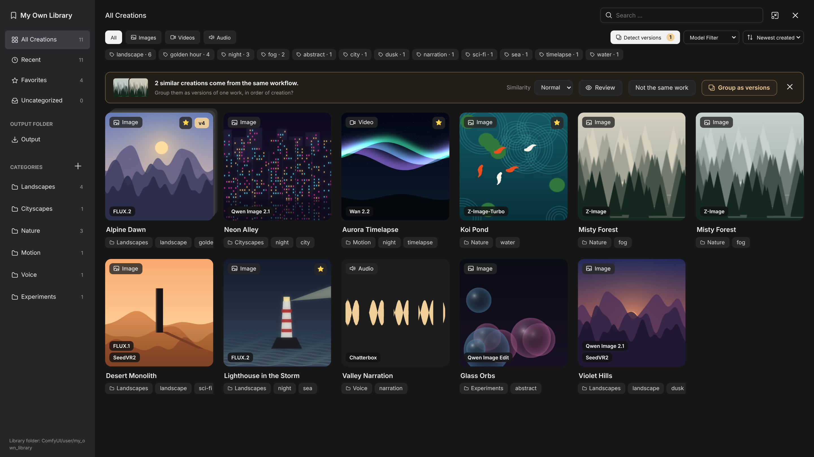

# ComfyUI - My Own Library



A personal library for your ComfyUI creations, in a window modeled on ComfyUI's Templates browser (same size, centered). The button next to the close button maximizes it to the whole screen (remembered), and a click outside the window closes it.

- **Output view**: lists every image, video and audio file in your `output` folder, newest first, with a badge on the ones already in your library and a **Hide added** toggle.
- **Library**: the creations you keep are **copied** into a separate library folder. You can then clean up `output` freely; your library keeps its own copies.
- **Clean up output**: files already copied to the library can be deleted from `output`, one at a time or in bulk, or right when you add them (**Remove from output after adding**). Deletion is permanent and only happens after checking that the library copy is complete.
- **Versions**: iterations of one work are grouped on a single card (**v4** badge), numbered in order of creation (or in the order you choose), with a strip to switch between them and a **Changes since** summary (seed, prompt changes shown in the text like tracked changes, models and LoRAs). The library suggests grouping creations that look (or sound) alike **and** come from the same workflow or the same source file (image-to-image); at the Loose level, near-identical creations are suggested whatever their origin; you can also group, separate and choose the cover by hand.
- **Duplicates**: a file identical to a creation already in the library (same file, or same pixels, frames or sound with different metadata, as when a workflow runs again with the same seed) is not copied twice. It is linked to that creation instead, so it counts as added and can be deleted from `output`. Identical creations already in the library are listed under **Duplicates**, where **Keep one** merges them.
- **Organize**: one category per creation (left column), any number of tags, a title, notes and a favorite star. Tags are suggested as you type, from the tags you already use.
- **Model families**: each thumbnail shows the families of the models that produced it, stacked in order of execution (for example Qwen Image 2.1 then SeedVR2), detected from the model file names and node types. Only models that actually contributed count: bypassed or muted nodes, and branches that don't lead to the node that saved the file, are ignored. You can correct the list per creation, and filter the library by family with **Model Filter** (several models can be ticked).
- **Prompts and settings**: positive and negative prompts, seed, models and LoRAs are read from the file's embedded ComfyUI metadata and shown next to the preview. Search looks into titles, notes, tags, prompts and model names.
- **Load workflow**: reopens the workflow that produced the creation, in a new tab.
- **New-files badge**: when a generation saves new images or videos to `output`, the library icon in the sidebar shows how many arrived since your last visit of the Output view. Clicking the icon opens the Output view on those new files, and the badge resets.
- **Videos**: MP4, WebM, MOV and MKV, with thumbnails and a muted hover preview (stopped as soon as you open a creation).
- **Audio**: FLAC, WAV, MP3, OGG/Opus and M4A, with a waveform thumbnail and a player in the detail panel. The text spoken by text-to-speech workflows is shown as **Text** and is searchable.

The package adds no nodes and imports nothing heavy, so it adds no measurable time to ComfyUI's startup. It does not hook node registration in the frontend either.

## Installation

In `ComfyUI/custom_nodes/`:

```
git clone https://github.com/laurentlasalle/comfyui-my-own-library
```

Then restart ComfyUI. No extra Python packages are needed. You can also download the ZIP from GitHub (**Code** > **Download ZIP**) and extract it in `custom_nodes`, naming the folder `comfyui-my-own-library`.

To update: `git pull` in that folder, then restart ComfyUI.

## Usage

Click the **My Own Library** icon (bookmark) in the left sidebar: the window opens directly. You can also use the **Open My Own Library** command.

| Action | How |
|---|---|
| Add creations | **Output** in the left column, tick the cards, pick a category in the bottom bar, then **Add to library**. Or open a file and use **Add to library** with a category and tags. |
| Add from a node | Right-click a **Save Image**, **Preview Image** or **Video Combine** node that has outputs, then **Add to My Own Library**. |
| Create, rename or delete a category | The **+** next to *Categories*; hover a category for the pencil and trash icons. Deleting a category never deletes creations, they become *Uncategorized*. |
| Edit a creation | Click its card. Title, category, model, tags and notes save automatically. |
| Tags | Type a few letters: matching tags appear, most used first. **↑** / **↓** to choose, **Enter** or **Tab** to take one, **Esc** to close the list. **Enter** on text that matches nothing creates a new tag. |
| Correct the model families | In a creation's detail panel, type in **Model**: the suggestions list the families of your library first, then every model known to this library and to ComfyUI's Browse Templates. Several families are separated with commas, in order of execution. Leave it empty to use the detected list. |
| Sort new generations | When the sidebar icon shows a number, click it: the Output view opens on the new files (**New since last visit**). Toggle that filter off to see everything. |
| Search | Type in **Search ...**; the icon at the right of the field, or **Esc**, clears it (a second **Esc** closes the window). |
| Sort | The menu with the ⇅ icon, next to **Model Filter**: newest or oldest created (default: newest created), newest or oldest added, largest or smallest first (a work counts the size of all its versions; hover a card to see it), or title. Your choice is remembered. |
| Browse | **←** / **→** move between creations, **Esc** goes back to the grid, then closes the window. |
| Suggestions and filters | The version suggestion follows the current view and filters: with **FLUX.2** selected, only FLUX.2 creations of a workflow are proposed, and **Not the same work** only sets those aside. |
| Review a suggestion | **Review** in the suggestion banner shows the creations in large thumbnails (click one to see it full size). Untick the ones that don't belong, then **Group N as versions**: only the ticked ones are grouped, and the others are not suggested again. Review then opens the next suggestion (**Suggestion 2 of 5** in the header); **Skip** leaves one for later. When every suggestion has been handled or skipped, you are back to the grid. |
| Detect versions | The **Detect versions** button, next to **Model Filter**, shows or hides the suggestion banner; it shows how many suggestions there are. The banner opens by itself when a new suggestion appears, and stays closed otherwise once you close it. |
| Similarity of suggestions | The **Similarity** menu in the suggestion banner (always there while the banner is open, even when nothing is found): **Strict** (near-identical variations only), **Normal** (default) or **Loose** (looser resemblance, more suggestions). Your choice is remembered. In **Review**, each card shows its lowest similarity to the other creations of the suggestion, so one that doesn't belong stands out. |
| Group versions | Accept the suggestion at the top of the library, or tick the cards to group (checkbox on hover) and use **Group as versions**. Title, category, tags and favorite are shared by the work; each version keeps its own notes. |
| Reorder versions | Drag a thumbnail of the version strip to another place, or use **Move earlier** / **Move later** in the detail panel (**Alt+↑** / **Alt+↓**) to move the version shown. Numbers and **Changes since** follow the new order. **Sort by date** puts the versions back in order of creation. When works are grouped together, each keeps its own order, and they are interleaved by date. |
| Browse versions | Click a version in the strip under the preview, or use **↑** / **↓**. **Set as cover** picks the version shown on the card; **Separate** makes a version a standalone creation again, with its own title and tags back. |
| Select in the output folder | **Select not in library** and **Select added** cover the whole output folder (within the current filters), not only the files displayed: the view loads 200 files at a time, but the selection, adding and deleting apply to every selected file. |
| Delete from output | In the Output view, **Select added** then **Delete N from output**, or **Delete from output** in a file's panel. Only files already in the library can be deleted, after confirmation. |
| Duplicates skipped when adding | A banner in the Output view lists the files that were not copied and which creation each one matches. **Add anyway** copies them as separate creations. |
| Merge duplicates | **Duplicates** in the left column (shown only when there are some). **Keep one** keeps a single creation per group: a version of a work if one of the copies is in a work, otherwise the first added. It gets the tags and notes of all the copies, stays a favorite if any copy was, and takes the oldest creation date. The other copies leave the library; files in `output` are not touched. **Keep one of each** does it for every group, after confirmation. |
| Follow a long operation | Adding, moving, deleting from output and removing from the library are done one file at a time. A progress bar replaces the action bar (other actions wait until it ends), with **Cancel** to stop after the current file; what is already done stays done. ComfyUI's terminal shows each file (`[My Own Library] Added 37/240: ...`) and a summary at the end. The Output view then refreshes with the files left, keeping the current filters and search. |
| Video thumbnail | Pause the video on the frame you want (or move along its timeline) and click **New thumbnail** at the top right of the player. **Reset thumbnail**, next to it once a thumbnail was chosen, goes back to the automatic one. The video keeps playing (or stays paused). A chosen thumbnail is never replaced automatically. |
| Segments of combined videos | Videos made of several segments (Easy-Media projects, or segments followed by a video whose length is their sum) are recognized in the Output view: the final video shows **Combined from N parts**, each segment **Part 2 of 4**. **Hide parts** (on by default) hides the segments. Once the final video is in your library, **Delete parts** lists the files that can go (segments and, for Easy-Media, their context latents), grouped by final video with their size, and deletes them after confirmation. The project's `project.json` and `out/` folder are always kept. |
| Remove a creation | **Remove** in its detail panel, clicked twice. This deletes the library copy only, never the file in `output`. |
| Work on several creations | Tick cards (checkbox on hover) or use **Select all shown** for the whole current view, then **Move to category**, **Add tags**, **Remove N from library** (a card with versions is removed with all its versions, after confirmation) or **Group as versions**. |

## How similarity is measured

Two creations are suggested as versions only if they are related and similar enough for the chosen level. Related means:

- **the same workflow**, or
- **the same source file**: the file loaded by a **Load Image** (or Load Video) node, as in image-to-image workflows, even when the workflows differ.

At the **Loose** level, creations without any such link are also suggested when they look almost identical (92 % or more). The banner says why: "come from the same workflow", "were made from the same source file" or "look almost identical".

 Variations of one image or video (another seed, a small edit, a color grade, a different size) usually score 85 % or more, unrelated results around 50 %.

- **Images**: overall structure (shapes, composition, light and dark areas) and the colors of a 4×4 grid, compared on the thumbnail.
- **Videos**: the same comparison on four frames spread over the video, plus the duration.
- **Audio**: the loudness envelope over time and the duration. A take with the same text and rhythm scores high; a different text or a much shorter clip doesn't.

Identical creations are duplicates rather than versions, so they are never suggested as versions of each other.

Groups are kept tight: a creation joins a suggestion only if it resembles **every** creation in it, not just one, so a long series can't drift from one look to another. Images and videos must also share their dominant colors, whatever their layout.

The signature of each creation is computed when you add it. Creations added before this version are processed once in the background the first time the library opens, which can take a moment for many videos or long audio files. Until then they are left out of the suggestions, and the banner shows how many are still being analyzed; the suggestions refresh by themselves when it's done. Files ffmpeg can't read are never suggested; you can still group them by hand.

## Settings

My Own Library has its own section in ComfyUI's **Settings** (gear icon), saved in your ComfyUI user profile:

| Section | Setting | Default | What it does |
|---|---|---|---|
| Options | New files badge on sidebar | On | Number of new output files on the library icon. |
| Options | Play videos on hover | On | Muted preview when the mouse is over a video card. |
| Options | Center thumbnails on faces | On | When a picture has a single face, the square crop of the grid is centered on it; portrait pictures are framed on their upper third. |
| Options | Similarity of version suggestions (default) | Normal | Strict, Normal or Loose; also changed from the Detect versions banner. |
| File Management | Library directory | `ComfyUI/user/my_own_library` | Where the library keeps its copies and data (see below). |
| File Management | Remove from output after adding (default) | Off | Whether that box is ticked when the library opens. |

Faces are found with OpenCV's face detector when OpenCV is installed (most ComfyUI setups have it through other custom nodes); without it, only the portrait framing applies. Faces of creations added before this feature are looked for once in the background. The detector's data file comes with the package for OpenCV versions that no longer include it (`data/`, OpenCV data under the Intel license kept in the file).

## Where things are stored

By default the library lives in `ComfyUI/user/my_own_library/`:

```
library.json            titles, categories, tags, notes
files/YYYY-MM/<id>.ext  copies of your creations (plus companion PNGs of videos)
meta/<id>.json          full prompt and workflow of each creation
thumbs/<id>.jpg         thumbnails
cache/                  thumbnails of output files, safe to delete
```

To keep the library somewhere else (another drive, for example), change **Library directory** in ComfyUI's Settings (**My Own Library** › **File Management**), or click the folder shown at the bottom of the library's left column. The new folder is checked, then you choose:

- **Move my library there**: everything is copied (with a progress bar, and each file in the terminal), the copy is checked, and only then the old folder is deleted.
- **Use that folder**: opens the library already in that folder (or starts an empty one); yours stays where it is.

No restart is needed. The folder is saved in `ComfyUI/user/my_own_library.config.json` (`"library_dir"`), which you can still edit by hand, ComfyUI stopped.

The `user` folder is not touched by ComfyUI updates, so the library survives them.

## Video thumbnails

Video thumbnails come from the companion PNG saved by VideoHelperSuite when it exists. Otherwise the first frames are extracted with ffmpeg (the system one, or the one bundled with `imageio-ffmpeg`, which VideoHelperSuite installs). Without ffmpeg, the browser shows the video's first frame directly. When that frame is nearly black (a fade in, a dark intro), frames further into the video are tried until one is bright enough. Thumbnails of videos added with an older version are checked once in the background and redone if they are too dark.

Background work (analyzing creations added with an older version, checking video thumbnails) is reported in ComfyUI's terminal: one line when it starts, one per thumbnail redone, and a summary.

## Metadata support

| File | Prompt and workflow read from |
|---|---|
| PNG | `prompt` and `workflow` text chunks (Save Image) |
| WebP, JPEG | EXIF strings `prompt:` and `workflow:` (Save Animated WEBP and similar) |
| MP4, MOV, M4V | companion PNG, otherwise the `prompt` and `workflow` tags (ComfyUI's Save Video, Easy-Media) or the `comment` tag (VideoHelperSuite) |
| WebM, MKV | companion PNG only |
| FLAC | Vorbis comments `prompt` and `workflow` (ComfyUI's Save Audio and similar) |
| M4A | same tags as MP4 |
| MP3, WAV, OGG/Opus | tags read through ffmpeg |

Files without metadata can still be added; their prompt section is simply empty.

When a workflow has no text-encoder node (MiniMax H3, text-to-speech, API nodes), the prompt is taken from the nodes' own text fields, including JSON project data such as Easy-Media's MultiTrack Editor (`user_prompt`). Text-to-speech nodes give the spoken text, shown as **Text**.

Only the nodes that contributed to the file are considered: the library finds the save node that wrote it (its `filename_prefix` matches the file name) and walks the links backwards. Switch nodes are followed on their active branch only.

Prompts are traced from each sampler's *positive* and *negative* inputs, following only the matching branch through nodes that carry both (PainterI2V, WanImageToVideo, ControlNet and similar). Seeds of samplers with **add_noise** disabled are ignored, since they are not used. Creations added with an older version are recalculated automatically the next time the library opens.

## Versions

See [CHANGELOG.md](CHANGELOG.md) for what changed in each version, and the Releases page of the repository. The installed version is shown at the bottom of the left column and in the terminal when ComfyUI starts.

## License

MIT. See [LICENSE](LICENSE).
